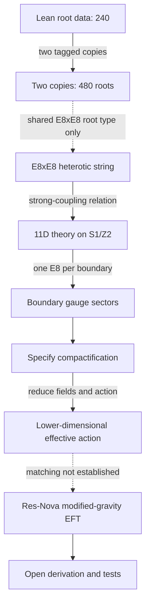

# String/M-Theory and Res-Nova: A Bounded Bridge

_A literature and formalization note for the Res-Nova repository._

---

## Short answer

There is a genuine structural connection between **E8×E8 root data**, the E8×E8 heterotic string, and its eleven-dimensional strong-coupling description. Hořava and Witten describe the latter using eleven-dimensional theory on an orbifold interval, with an E8 gauge sector on each boundary.[^1][^2]

That established connection does **not** yet connect the Res-Nova modified-gravity sector to string/M-theory. The repository formalizes the finite E8 root system and now counts two tagged copies. Neither that arithmetic nor the cited string literature derives Res-Nova’s modified-gravity action, its MOND-like behavior, or its acceleration scale `a₀`.

## Status at a glance

| Topic | Status | What that means |
| --- | --- | --- |
| Finite E8 root set (240) | Formalized here | Root subtype and count in Lean |
| E8×E8 heterotic / eleven-dimensional relation | Established in cited theory[^1][^2] | Strong-coupling orbifold framework |
| Derivation to Res-Nova gravity or `a₀` | Open for Res-Nova | No reduced action or parameter match |

## What established theory connects

Hořava and Witten proposed that the strong-coupling limit of the ten-dimensional E8×E8 heterotic string is described by an eleven-dimensional theory on `R¹⁰ × S¹/Z₂`.[^1] Their boundary analysis finds a copy of E8 on each boundary component and relates the gauge coupling to the gravitational coupling within that framework.[^2]

There are concrete compactification calculations beyond this high-level correspondence. Witten studied the strong-coupling expansion of E8×E8 compactification on a Calabi–Yau manifold.[^3] Lukas, Ovrut, Stelle, and Waldram derived a five-dimensional effective action by reducing M-theory on `S¹/Z₂ × Calabi–Yau`, then obtained a four-dimensional theory by a further reduction on a domain-wall background.[^4] These papers show what a real bridge requires: specified geometry, fields, boundary data, and an explicit reduced action—not just a shared group label.

The dashed arrows are deliberately limited: the Lean root count shares E8×E8 root-system structure with the heterotic setup, while a derivation from a compactified M-theory action to Res-Nova has **not** been supplied.

## What is formalized here

[`E8Roots.lean`](../05_lean_formalization/E8Roots.lean) defines the doubled-coordinate E8 root subtype and proves that it has 240 elements. [`StringTheoryBridge.lean`](../05_lean_formalization/StringTheoryBridge.lean) tags each root with a left or right factor and proves that the resulting product has 480 elements. It separately records the rank bookkeeping `8 + 8 = 16` and proves the arithmetic `480 + 16 = 496`.

The rank value is an explicit bookkeeping constant in the new module; it is not derived there from the root subtype. The module also does not construct an E8 Lie algebra, prove a gauge-algebra dimension theorem, or formalize heterotic string theory. In particular, the number 496 here is only the stated root-count-plus-rank sum. It is not evidence for a connection to `a₀` or to the galaxy sector.

## What remains open for Res-Nova

A physical connection would require a concrete model and a chain of calculations that can be checked independently:

1. Choose and justify a compactification geometry, internal space, boundary conditions, and any gauge bundle or flux data.
2. Identify which lower-dimensional fields and symmetries correspond to the metric and scalar sector used by Res-Nova.
3. Perform the reduction and derive the complete effective action, including normalizations, signs, and couplings; do not insert the desired modified-gravity law as an assumption.
4. Derive, rather than fit or identify by numerology, whether the reduced theory predicts the Res-Nova interpolation law and a value or relation for `a₀`.
5. Test that same fixed model against the repository’s existing stability, gravitational-wave, Solar-System, and SPARC constraints, without retuning parameters between tests.

Until those steps are done, the relationship is a research direction, not a solution or unification result. The root count, triality, and E8×E8 label alone do not imply the Res-Nova force law or any of its constants. No `240²` interpretation is used here.

## Sources

[^1]: P. Hořava and E. Witten. (1996). “Heterotic and Type I String Dynamics from Eleven Dimensions.” *Nuclear Physics B*, 460, 506–524. https://arxiv.org/abs/hep-th/9510209

[^2]: P. Hořava and E. Witten. (1996). “Eleven-Dimensional Supergravity on a Manifold with Boundary.” *Nuclear Physics B*, 475, 94–114. https://arxiv.org/abs/hep-th/9603142

[^3]: E. Witten. (1996). “Strong Coupling Expansion Of Calabi-Yau Compactification.” *Nuclear Physics B*, 471, 135–158. https://arxiv.org/abs/hep-th/9602070

[^4]: A. Lukas, B. A. Ovrut, K. S. Stelle, and D. Waldram. (1999). “Heterotic M-theory in Five Dimensions.” *Nuclear Physics B*, 552, 246–290. https://arxiv.org/abs/hep-th/9806051
